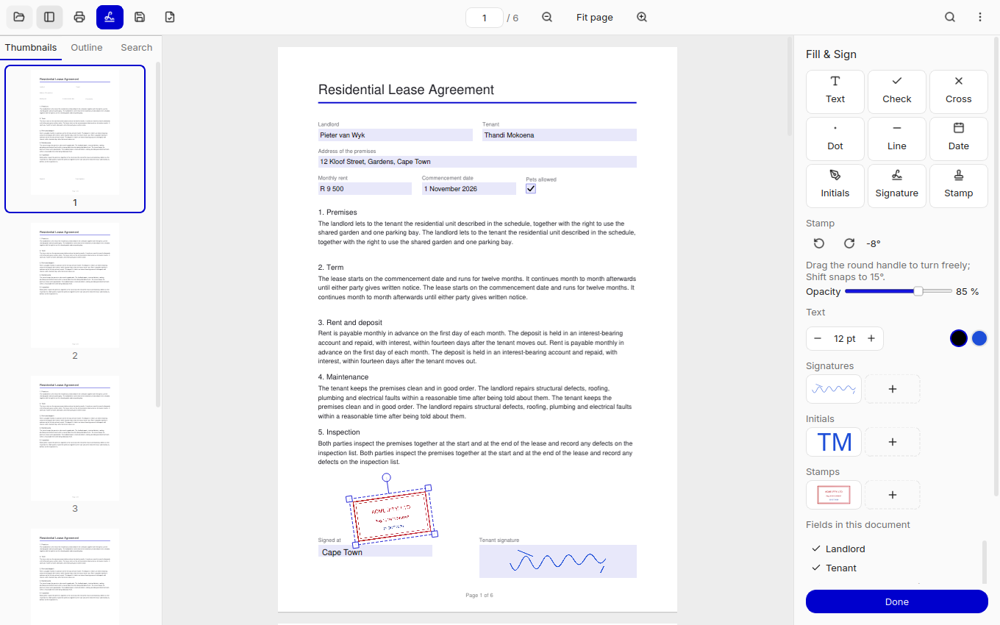
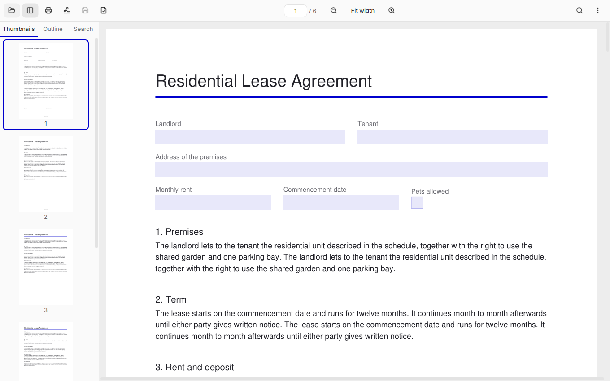
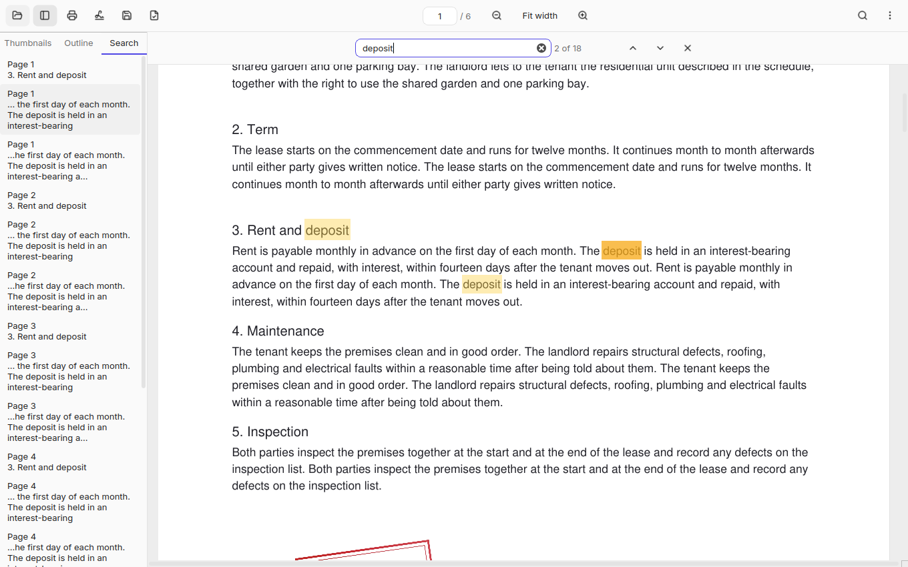
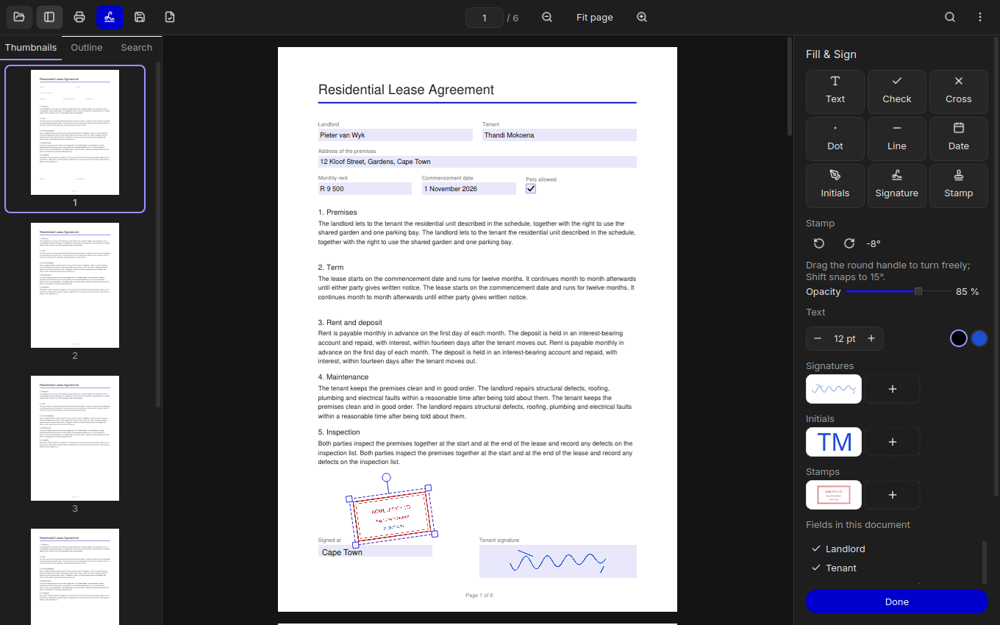
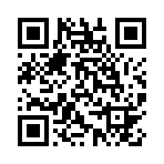

# PDR Sign

Portable Document Read and Sign: a fast, private PDF reader with Fill & Sign, for the
Ubuntu desktop. Your documents never leave your computer.

**Free forever, supported by donations.** No ads, no subscriptions, no paywalled
features — ever.



| Reading | Searching | Dark theme |
|---|---|---|
|  |  |  |

## Features

- **Read:** continuous scroll, crisp HiDPI rendering, thumbnails, outline, links,
  full-text search, text selection and copy, tabs, recent files.
- **Fill:** click any form field to start filling; add text, ✓, ✗, dots, lines and
  dates anywhere on the page; undo and redo everything.
- **Sign:** draw a signature, type it in a handwriting font, or clean up a phone photo
  of it; the same for initials. Saved signatures stay on your computer.
- **Stamp:** upload a scan or photo of a company stamp — the background is removed and
  its colours kept; place it at its real size, turn and fade it.
- **Save:** your entries stay editable in PDR Sign and visible in every PDF reader.
  **Save signed copy** writes a new file next to the original with everything fixed
  into the pages; the original stays unchanged for corrections.
- **Print:** one dialog with printer, page range, copies, paper, orientation and
  "Fit to page" / "Actual size".

## Install

### Snap Store (recommended)

```bash
sudo snap install pdr-sign
```

**Printing, once:** a snap can only reach your printers after you allow it. Run this one
time (PDR Sign shows the same command, with a Copy button, in its print dialog):

```bash
sudo snap connect pdr-sign:cups-control
```

To open PDFs from USB sticks and other drives, also run
`sudo snap connect pdr-sign:removable-media` once.

### .deb (Ubuntu 22.04 and newer)

Download `pdr-sign_<version>_amd64.deb` from the
[Releases](https://github.com/Laymer000007/pdr-sign/releases) page, then:

```bash
sudo apt install ./pdr-sign_1.0.0_amd64.deb
```

Remove it with `sudo apt remove pdr-sign`.

### AppImage (any recent Linux distribution)

Download `PDR-sign-<version>-x86_64.AppImage` from the
[Releases](https://github.com/Laymer000007/pdr-sign/releases) page, then:

```bash
chmod +x PDR-sign-1.0.0-x86_64.AppImage
./PDR-sign-1.0.0-x86_64.AppImage
```

### Check your download

Every release has a `SHA256SUMS` file. In the download folder:

```bash
sha256sum -c SHA256SUMS --ignore-missing
```

To check that an installed copy works, `pdr-sign --self-test ~/pdr-selftest` saves,
signs and prints test files into that folder and reports what worked.

## Support

PDR Sign is free and open source, and always will be. If it saves you time, please
consider buying me a coffee. Your support funds what's next:

- Digital certificate signatures
- Highlight, underline and comments
- Rotate, reorder and delete pages
- Merge and split PDFs
- Text recognition (OCR) for scanned documents

**Buy me a coffee with Zcash (ZEC):** `t1J43HtBcvFmtYmJF7waapPcJtKHUwDY8mf`



The same address and QR code are in the app: the coffee button in the header, or
About → Support PDR Sign.

## Feedback

Ideas or feedback? I'd love to hear from you: [micro_korn@hotmail.com](mailto:micro_korn@hotmail.com).

## Reporting a problem

Open an issue on [GitHub Issues](https://github.com/Laymer000007/pdr-sign/issues) and
pick **Bug report** or **Feature request**. For a bug, please include the PDR Sign
version (About), how you installed it (snap, .deb or AppImage), your Ubuntu version,
and the steps to reproduce. Don't attach PDFs with personal data.

Security problems: please report them privately, as described in
[SECURITY.md](SECURITY.md).

## Run from source

Requires Python 3.12. With [uv](https://docs.astral.sh/uv/):

```bash
uv venv --python 3.12 .venv
uv pip install --python .venv -e ".[dev]"
.venv/bin/python -m pdr_sign [file.pdf]
```

## Development

```bash
.venv/bin/ruff check . && .venv/bin/ruff format --check .
.venv/bin/mypy
.venv/bin/pytest -m "not slow"
```

Packaging: `pyinstaller packaging/pdr-sign.spec`, then `packaging/appimage/build.sh` and
`packaging/deb/build.sh`; the snap builds in CI from `packaging/snap/snapcraft.yaml`
(`.github/workflows/packages.yml`). Manual release checks: [docs/TESTING.md](docs/TESTING.md).
Changes per version: [CHANGELOG.md](CHANGELOG.md).

## Licence

PDR Sign is free software, licensed under the **GNU Affero General Public License v3.0
or later** (see [LICENSE](LICENSE)). It is built on PyMuPDF/MuPDF, which is
AGPL-licensed. Third-party components and their licences are listed in
[THIRD_PARTY_NOTICES.md](THIRD_PARTY_NOTICES.md).
